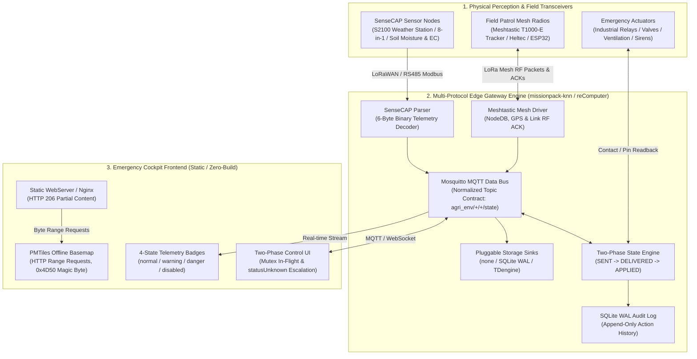

# SenseCraft Emergency Response Cockpit

[](LICENSE)
[](#supported-hardware--ecosystem)
[](#system-architecture)
[](#offline-map-configuration-pmtiles)
[](#features)

Lightweight, off-grid emergency response and disaster resilience cockpit template aligned with SenseCraft-UI. Designed for edge gateways (reComputer R1000/R1100/R12, Raspberry Pi) and zero-internet field operations.

English | [简体中文](README.zh-CN.md)

---

## System Architecture

The cockpit operates not as an isolated web UI, but as the operational presentation layer deeply integrated with Seeed's Multi-Protocol Edge Gateway Engine (e.g., `missionpack-knn` on reComputer industrial gateways). The end-to-end architecture connects field sensing, off-grid mesh communication, two-phase physical actuation, and client-side offline GIS rendering:



---

## Features

1. **SenseCraft-UI Design System**
   - Strictly implements `@suharvest/ui-kit` design tokens (`--sc-color-primary: #8CC020`, `--sc-color-bg-layout: #f7fbf0`).
   - Standardized 4-state telemetry badges: `normal` (green), `warning` (yellow), `danger` (red), and `disabled` (gray).
   - Built-in dual-language dictionary (`en` / `zh`), selectable via header switch or URL query parameter (`?lang=en` / `?lang=zh`).

2. **Offline Vector Basemap (PMTiles)**
   - Consumes local `.pmtiles` single-file archives using `protomaps-leaflet` via HTTP 206 Partial Content (HTTP Range requests).
   - Operates in complete network isolation with no external GIS or cloud tile service dependencies.
   - Built-in preflight magic byte check (`0x4D50`) with graceful fallback to OpenStreetMap when online or to tabular marker lists.

3. **Two-Phase Physical Control Confirmation State Machine**
   - Eliminates optimistic false-success feedback in safety-critical operations.
   - **Phase 1: `SENT`**: Local dispatch confirmed from edge gateway to outbound radio/bus link.
   - **Phase 2: `DELIVERED`**: Remote transceiver delivery confirmed via Meshtastic LoRa RF ACK packet.
   - **Phase 3: `APPLIED`**: Actuator physical pin / contact readback confirmed to complete the loop.
   - Timeout escalation transitions commands to `statusUnknown` warning state, accompanied by persistent append-only WAL audit logging on the gateway.

4. **Decoupled Time-Series Storage**
   - Compatible with gateway `STORAGE_BACKEND` modes: `none` (pure stream pass-through), `sqlite` (local cyclic cache with WAL), or `tdengine` (centralized time-series cluster).
   - Frontend auto-adapts status display and subscriptions based on detected backend capability.

5. **Zero Heavy Framework & Edge Optimized**
   - Implemented in native ECMAScript modules and vanilla CSS.
   - Requires no Node.js compilation pipeline for production serving; deployable as static assets on minimal web servers (few tens of MBs RAM footprint).

---

## Multi-Protocol Edge Gateway Integration

The cockpit is engineered to interface directly with Seeed edge multi-protocol gateway software bases (such as `missionpack-knn` running on reComputer industrial edge controllers). The gateway serves as the physical mediation layer between disparate field hardware and the unified cockpit telemetry bus via 5 core architectural mechanisms:

### 1. SenseCAP Sensor Protocol Adapter
- **6-Byte Binary Measurement Parsing**: Decodes industrial binary streams where telemetry measurements follow fixed 6-byte blocks (`Measurement ID` [2 bytes] + `Measurement Value` [4 bytes, IEEE 754 float or signed integer]), strictly aligned with Seeed SenseCAP standard data definitions.
- **Hardware Profile Alignment**: Direct out-of-the-box decoders for SenseCAP S2100 data loggers, 8-in-1 compact weather stations, multi-depth soil moisture/temperature/electrical conductivity (EC) sensors, and PAR light intensity instruments.
- **Dual Transport Ingestion**: Ingests sensor data over both ChirpStack v4 LoRaWAN uplinks and industrial RS485 Modbus RTU buses simultaneously.
- **Fault-Isolated Parsing**: Implements per-metric error isolation, monotonic millisecond timestamp alignment, and anti-drift validation to ensure corrupted telemetry packets never disrupt adjacent channels.

### 2. Meshtastic LoRa Mesh Off-Grid Communication Driver
- **Zero-Cellular Field Coordination**: Establishes reliable communication across rugged terrain, dense forests, or disaster zones without cellular infrastructure or internet backhaul.
- **Supported Patrol Terminals**: Interoperates with off-grid field ranger hardware including Seeed SenseCAP T1000-E trackers, Heltec LoRa Mesh nodes, and custom ESP32 transceivers.
- **NodeDB Mesh Discovery**: Maintains dynamic neighbor tables, multi-hop routing paths, hop counts, and radio SNR metrics.
- **Telemetry & GPS Decoding**: Handles fixed-point `1e7` coordinate conversions (preserving valid zero coordinates and avoiding boolean false values in battery metrics) alongside short emergency broadcast messages.
- **Hardware RF ACK Validation**: Captures link-layer RF acknowledgement frames transmitted by remote mesh radios to verify physical delivery of critical alerts.

### 3. Two-Phase Physical Control State Machine Engine
- **No Optimistic False-Success**: Critical operations (e.g., activating high-volume drainage pumps, triggering ventilation shutters, or sounding sirens) require physical verification before marking the action as successful.
- **Three-Stage Closed Loop**:
  - `SENT`: Outbound command payload validated and dispatched from the edge gateway onto the physical communication channel.
  - `DELIVERED`: Remote transceiver signals link-layer delivery confirmation (via Meshtastic RF ACK or bus echo).
  - `APPLIED`: Actuator auxiliary feedback pin / contact closure is read back through hardware GPIO or Modbus coil confirmation.
- **Single-Flight In-Flight Mutex**: Enforces a strict mutex on each target channel (only one in-flight command allowed per actuator pin) to prevent race conditions and command queue thrashing.
- **Monotonic Timeout Escalation**: Operates a monotonic clock-driven watchdog (`time.monotonic()`); if contact closure is not confirmed within the configured window, state escalates to `statusUnknown`.
- **SQLite WAL Audit Trail**: Every command transition, operator ID, target pin, timestamp, and final disposition is committed to an append-only SQLite WAL database on the gateway, preventing replay attacks and ensuring post-incident forensic traceability.

### 4. Pluggable Storage Sinks
- **Dynamic Engine Switching**: Configured via the `STORAGE_BACKEND` environment variable on the edge gateway without modifying application code:
  - `none`: Pure in-memory streaming mode. Sensor metrics and control events are broadcast directly to MQTT and WebSocket clients with minimal memory overhead, ideal for resource-constrained edge SBCs.
  - `sqlite`: Local circular buffer with Write-Ahead Logging (WAL). Retains a rolling window of telemetry (e.g., 24h/48h) with automatic partition age-off, surviving power cuts and maintaining offline trend charts.
  - `tdengine`: Enterprise-grade, high-throughput time-series database cluster integration for multi-station field deployments and historical analysis.
- **Adaptive Frontend Rendering**: The cockpit automatically senses the active storage sink, displaying real-time stream indicators or populating multi-day trend graphs accordingly.

### 5. Normalized MQTT Data Bus Contract
- **Loose Coupling**: Frontend presentation components and backend acquisition daemons interact strictly through normalized topic schemas:
  - **Telemetry Stream Topic**: `agri_env/{station_id}/{sensor_type}/state` (e.g., `agri_env/station_alpha/soil/state`, `agri_env/station_alpha/weather/state`), carrying standardized JSON payloads:
    ```json
    {
      "station_id": "station_alpha",
      "sensor_type": "weather",
      "timestamp": 1729411200000,
      "metrics": {
        "air_temperature": 24.5,
        "air_humidity": 68.2,
        "barometric_pressure": 1013.2,
        "wind_speed": 3.4,
        "wind_direction": 180,
        "rainfall_hourly": 0.0
      },
      "status": "normal"
    }
    ```
  - **Patrol Mesh Topic**: `msh/{mesh_channel}/node/{node_id}/telemetry` for live ranger coordinates, battery levels, and telemetry badges.
  - **Control Bus Contract**: `control/command` for dispatching actions and `control/state` for streaming real-time transition updates (`SENT`, `DELIVERED`, `APPLIED`, `statusUnknown`).

---

## Quick Start

### Method 1: Zero-Build Static HTTP Server (Python)

Serve the directory directly using Python's built-in HTTP server:

```bash
# Start HTTP server on port 8080
python3 -m http.server 8080

# Open in browser:
# Default language: http://localhost:8080/index.html
# English interface: http://localhost:8080/index.html?lang=en
# Chinese interface: http://localhost:8080/index.html?lang=zh
```

### Method 2: Docker Container (Production Nginx)

Run using the included production container configuration (`Dockerfile` and `nginx.conf`). The Nginx configuration includes native HTTP 206 Range support, gzip compression bypass for `.pmtiles` offsets, and health check monitoring:

```bash
# Build the Docker image
docker build -t emergency-response-cockpit .

# Run container with optional local PMTiles volume mount
docker run -d \
  --name emergency-cockpit \
  -p 8080:80 \
  -v $(pwd)/uploads/pmtiles:/usr/share/nginx/html/uploads/pmtiles:ro \
  emergency-response-cockpit

# Verify container healthcheck
curl -f http://localhost:8080/healthz
```

### Method 3: Vite Development Server

For local development with hot module reloading:

```bash
npm install
npm run dev
```

---

## Offline Map Configuration (PMTiles)

The cockpit renders high-performance vector basemaps without external tile server dependencies via the PMTiles v3 format:

1. **Prepare Vector Tiles**: Generate or download the target area `.pmtiles` vector archive (using tools such as Tippecanoe, Planetiler, or extraction scripts).
2. **Directory Placement**: Place the `.pmtiles` archive into the `uploads/pmtiles/` directory (e.g., `uploads/pmtiles/site.pmtiles`).
3. **HTTP 206 Range Verification**: In production, `nginx.conf` is preconfigured to provide `Accept-Ranges bytes` response headers and disallow gzip compression for `.pmtiles` files to guarantee byte-offset fidelity.
4. **Magic Byte Check & Fallback**: The client-side map component (`src/components/OfflineMapView.js`) inspects the initial 2-byte header magic sequence (`0x4D50` / ASCII `'PM'`) via an HTTP Range preflight check. If the archive is missing or inaccessible, the map gracefully falls back to public OpenStreetMap tiles (if network is present) or displays a tabular marker fallback view.

---

## Industry Examples

This repository includes a fully functional, self-contained reference implementation:

- [**examples/agri-env-ops**](examples/agri-env-ops/README.md): **Smart Agricultural Meteorology & Off-Grid Patrol Cockpit**
  - **Operational Scenarios**: Farmland microclimate stations (temperature, humidity, wind rose, precipitation, atmospheric pressure), greenhouse soil moisture/EC profiling, and field patrol personnel tracking via Meshtastic LoRa Mesh radios (T1000-E).
  - **Edge Gateway Integration**: Integrates with the `missionpack-knn` edge gateway, parsing standard Seeed SenseCAP sensor packets and subscribing to `agri_env/+/+/state` MQTT topics.
  - **Integrated Simulator**: Includes a Python bridge and demo simulator (`python3 bridge.py --demo`), standalone operations dashboard, kiosk display view (`kiosk.html`), and Docker Compose deployment.

---

## Supported Hardware & Ecosystem

| Component Category | Supported Hardware & Protocols | Application Function |
| :--- | :--- | :--- |
| **Edge Gateways** | Seeed reComputer R1000 / R1100 / R12, Raspberry Pi 4 / 5, CM4 Industrial Host | Gateway runtime, Mosquitto MQTT broker, SQLite WAL audit logging, PMTiles static file serving |
| **Sensing Nodes** | SenseCAP S2100 series (Soil Moisture/EC, Temp/RH, 8-in-1 Weather Station) | Farmland microclimate and physical hazard sensing over RS485 / LoRaWAN |
| **Field Patrol** | SenseCAP T1000-E Tracker, Heltec LoRa Mesh transceivers, ESP32 LoRa nodes | Off-grid field ranger telemetry, GPS location reporting, and RF ACK confirmation |
| **Protocol Support** | SenseCAP Measurement Protocol, LoRaWAN, Meshtastic LoRa RF, MQTT, PMTiles v3 | Normalized 6-byte sensor decoding, mesh RF ACK validation, HTTP 206 partial content streaming |
| **Actuator Control** | Industrial Relays, Modbus Coils, GPIO Relay Boards | Two-phase control execution with physical contact readback confirmation |

---

## Project Structure

```text
emergency-response-cockpit/
├── Dockerfile                     # Production Nginx container definition
├── LICENSE                        # MIT License
├── README.md                      # English documentation and architecture guide
├── README.zh-CN.md                # 简体中文完整文档与网关协同架构指南
├── index.html                     # Application entry point with SenseCraft AppShell layout
├── nginx.conf                     # Nginx server configuration with HTTP 206 Range support
├── package.json                   # Project metadata and development dependencies
├── docs/
│   └── esg-emergency-solution-handoff.md  # ESG and emergency resilience solution architecture handoff
├── src/
│   ├── main.js                    # Orchestration, data polling, and state dispatch
│   ├── i18n/
│   │   └── index.js               # Bilingual dictionary (zh/en) and language switcher
│   ├── theme/
│   │   └── tokens.css             # SenseCraft UI official design tokens
│   └── components/
│       ├── MetricCard.js          # 4-state telemetry metric cards
│       ├── OfflineMapView.js      # PMTiles offline vector map with OSM fallback
│       └── TwoPhaseControlButton.js # Two-phase physical confirmation control button
└── examples/
    └── agri-env-ops/              # Smart agriculture meteorology & Meshtastic patrol dashboard
        ├── Dockerfile             # Example container definition
        ├── README.md              # Example documentation
        ├── bridge.py              # Protocol bridge and simulator server
        ├── docker-compose.yml     # Multi-container orchestration
        ├── index.html             # Agriculture operations entry
        ├── kiosk.html             # Field kiosk full-screen view
        └── ...                    # Associated scripts and styling
```

---

## License & References

- This project is licensed under the MIT License - see the [LICENSE](LICENSE) file for details.
- For ESG and disaster resilience solution design principles, cross-repository integrations, and business mapping, refer to [docs/esg-emergency-solution-handoff.md](docs/esg-emergency-solution-handoff.md).
