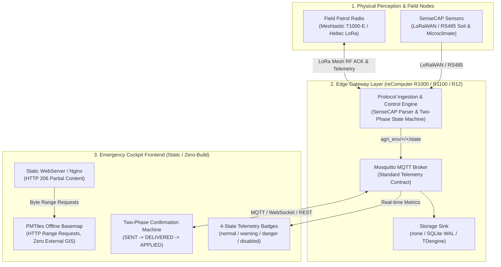

# SenseCraft Emergency Response Cockpit

[](LICENSE)
[](#supported-hardware--ecosystem)
[](#system-architecture)
[](#features)
[](#features)

Lightweight, off-grid emergency response and disaster resilience cockpit template aligned with SenseCraft-UI. Designed for edge gateways (reComputer R1000/R1100/R12, Raspberry Pi) and zero-internet field operations.

[English](#features) | [中文说明](#中文导读)

---

## System Architecture



---

## Features

1. **SenseCraft-UI Design System**
   - Strictly implements `@suharvest/ui-kit` design tokens (`--sc-color-primary: #8CC020`, `--sc-color-bg-layout: #f7fbf0`).
   - Standardized 4-state telemetry badges: `normal` (green), `warning` (yellow), `danger` (red), and `disabled` (gray).
   - Built-in dual-language dictionary (`en` / `zh`), selectable via header switch or URL query parameter (`?lang=en` / `?lang=zh`).

2. **Offline Vector Basemap (PMTiles)**
   - Consumes local `.pmtiles` single-file archives using `protomaps-leaflet` via HTTP 206 Partial Content (HTTP Range requests).
   - Operates in complete network isolation with no external GIS or cloud tile service dependencies.
   - Built-in preflight magic byte check (`0x4D50`) with graceful fallback to OpenStreetMap when online or to tabular marker lists.

3. **Two-Phase Physical Control Confirmation State Machine**
   - Prevents optimistic, unconfirmed control feedback in safety-critical operations.
   - **Phase 1: `SENT`**: Local dispatch confirmed from edge gateway to outbound radio link.
   - **Phase 2: `DELIVERED`**: Remote transceiver delivery confirmed via Meshtastic LoRa RF ACK packet.
   - **Phase 3: `APPLIED`**: Actuator physical pin / contact readback confirmed to complete the loop.
   - Timeout escalation transitions commands to `statusUnknown` warning state, accompanied by persistent append-only WAL audit logging on the gateway.

4. **Decoupled Time-Series Storage**
   - Compatible with gateway `STORAGE_BACKEND` modes: `none` (pure stream pass-through), `sqlite` (local cyclic cache with WAL), or `tdengine` (centralized time-series cluster).
   - Frontend auto-adapts status display and subscriptions based on detected backend capability.

5. **Zero Heavy Framework**
   - Implemented in native ECMAScript modules and vanilla CSS.
   - Requires no Node.js compilation pipeline for production serving; deployable as static assets on minimal web servers.

---

## Quick Start

### Method 1: Zero-Build Static HTTP Server (Python)

Serve the directory directly using Python's built-in HTTP server:

```bash
# Start HTTP server on port 8080
python3 -m http.server 8080

# Open in browser:
# Default language: http://localhost:8080/index.html
# English interface: http://localhost:8080/index.html?lang=en
```

### Method 2: Docker Container (Production Nginx)

Run using the included production container configuration (`Dockerfile` and `nginx.conf`). The Nginx configuration includes native HTTP 206 Range support, gzip compression bypass for `.pmtiles` offsets, and health check monitoring:

```bash
# Build the Docker image
docker build -t emergency-response-cockpit .

# Run container with optional local PMTiles volume mount
docker run -d \
  --name emergency-cockpit \
  -p 8080:80 \
  -v $(pwd)/uploads/pmtiles:/usr/share/nginx/html/uploads/pmtiles:ro \
  emergency-response-cockpit

# Verify container healthcheck
curl -f http://localhost:8080/healthz
```

### Method 3: Vite Development Server

For local development with hot module reloading:

```bash
npm install
npm run dev
```

---

## Industry Examples

This repository includes a fully functional, self-contained reference implementation:

- [**examples/agri-env-ops**](examples/agri-env-ops/README.md): **Smart Agricultural Meteorology & Off-Grid Patrol Cockpit**
  - **Operational Scenarios**: Farmland microclimate stations (temperature, humidity, wind rose, precipitation, atmospheric pressure), greenhouse soil moisture/EC profiling, and field patrol personnel tracking via Meshtastic LoRa Mesh radios (T1000-E).
  - **Edge Gateway Integration**: Integrates with the `missionpack-knn` edge gateway, parsing standard Seeed SenseCAP sensor packets and subscribing to `agri_env/+/+/state` MQTT topics.
  - **Integrated Simulator**: Includes a Python bridge and demo simulator (`python3 bridge.py --demo`), standalone operations dashboard, kiosk display view (`kiosk.html`), and Docker Compose deployment.

---

## Supported Hardware & Ecosystem

| Component Category | Supported Hardware & Protocols | Application Function |
| :--- | :--- | :--- |
| **Edge Gateways** | Seeed reComputer R1000 / R1100 / R12, Raspberry Pi 4 / 5, CM4 Industrial Host | Gateway runtime, Mosquitto MQTT broker, SQLite WAL audit logging, PMTiles static file serving |
| **Sensing Nodes** | SenseCAP S2100 series (Soil Moisture/EC, Temp/RH, 8-in-1 Weather Station) | Farmland microclimate and physical hazard sensing over RS485 / LoRaWAN |
| **Field Patrol** | SenseCAP T1000-E Tracker, Heltec LoRa Mesh transceivers | Off-grid field ranger telemetry, GPS location reporting, and RF ACK confirmation |
| **Protocol Support** | SenseCAP Measurement Protocol, LoRaWAN, Meshtastic LoRa RF, MQTT, PMTiles v3 | Normalized 6-byte sensor decoding, mesh RF ACK validation, HTTP 206 partial content streaming |

---

## Project Structure

```text
emergency-response-cockpit/
├── Dockerfile                     # Production Nginx container definition
├── LICENSE                        # MIT License
├── README.md                      # Cockpit documentation and developer guide
├── index.html                     # Application entry point with SenseCraft AppShell layout
├── nginx.conf                     # Nginx server configuration with HTTP 206 Range support
├── package.json                   # Project metadata and development dependencies
├── docs/
│   └── esg-emergency-solution-handoff.md  # ESG and emergency resilience solution architecture handoff
├── src/
│   ├── main.js                    # Orchestration, data polling, and state dispatch
│   ├── i18n/
│   │   └── index.js               # Bilingual dictionary (zh/en) and language switcher
│   ├── theme/
│   │   └── tokens.css             # SenseCraft UI official design tokens
│   └── components/
│       ├── MetricCard.js          # 4-state telemetry metric cards
│       ├── OfflineMapView.js      # PMTiles offline vector map with OSM fallback
│       └── TwoPhaseControlButton.js # Two-phase physical confirmation control button
└── examples/
    └── agri-env-ops/              # Smart agriculture meteorology & Meshtastic patrol dashboard
        ├── Dockerfile             # Example container definition
        ├── README.md              # Example documentation
        ├── bridge.py              # Protocol bridge and simulator server
        ├── docker-compose.yml     # Multi-container orchestration
        ├── index.html             # Agriculture operations entry
        ├── kiosk.html             # Field kiosk full-screen view
        └── ...                    # Associated scripts and styling
```

---

## 中文导读

### 核心特性摘要

SenseCraft Emergency Response Cockpit 是一个面向应急响应、防灾减灾与离网作业现场的单一开箱即用驾驶舱前端模板。

1. **SenseCraft UI 视觉语言**：严格遵循 `@suharvest/ui-kit` 设计 Tokens（主色 `--sc-color-primary: #8CC020`、背景色 `--sc-color-bg-layout: #f7fbf0`），内置 `normal`（绿）、`warning`（黄）、`danger`（红）、`disabled`（灰）四态指标规范，支持中英双语切换。
2. **PMTiles 离线矢量地图**：通过 `protomaps-leaflet` 对本地单文件 `.pmtiles` 发起 HTTP 206 范围请求（HTTP Range Request），彻底摆脱外部 GIS 或公网瓦片依赖，断网下支持缩放与标记渲染，并具备在线 OSM 平滑回退能力。
3. **两段式物理控制状态机**：针对防灾与工业继电器控制杜绝假“成功”。从下发到确认经历 `SENT`（本地网关已下发） -> `DELIVERED`（远端 Meshtastic RF 收到 ACK） -> `APPLIED`（硬件触点状态回读闭环）。若超时未收到回读，自动转入 `statusUnknown` 告警态，并在网关端写入 SQLite WAL 审计记录。
4. **时序存储解耦**：适配边缘网关的 `STORAGE_BACKEND` 配置（`none` 纯流式透传 / `sqlite` 本地环形存储 / `tdengine` 集中时序库）。
5. **零重量级框架开箱即用**：采用原生 ES 模块与纯 CSS，无打包强依赖，几十 MB 内存开销即可在边缘工控机稳定运行。

### 快速上手指南

- **方式 1：Python 静态文件服务（零构建，秒级拉起）**
  ```bash
  python3 -m http.server 8080
  # 访问 http://localhost:8080/index.html
  ```
- **方式 2：Docker 容器部署（内置 Nginx 生产配置）**
  ```bash
  docker build -t emergency-response-cockpit .
  docker run -d -p 8080:80 \
    -v $(pwd)/uploads/pmtiles:/usr/share/nginx/html/uploads/pmtiles:ro \
    --name emergency-cockpit emergency-response-cockpit
  ```
- **方式 3：Vite 本地开发**
  ```bash
  npm install
  npm run dev
  ```

### 离线地图配置指引

1. 准备目标区域的 `.pmtiles` 矢量切片文件（可通过 Tippecanoe 或 Planetiler 生成）；
2. 将文件保存至 `uploads/pmtiles/` 目录（例如 `uploads/pmtiles/site.pmtiles`）；
3. 生产环境中，`nginx.conf` 已默认配置针对 `.pmtiles` 的 `Accept-Ranges bytes` 响应头并关闭 gzip，以确保字节偏移严格准确；
4. 前端组件 `src/components/OfflineMapView.js` 会在加载前校验魔数 `0x4D50`，若文件不可用则自动回退至在线 OpenStreetMap 或测点信息卡片列表。

---

## License

This project is licensed under the MIT License - see the [LICENSE](LICENSE) file for details.

For architecture designs and solution handoff details, refer to [docs/esg-emergency-solution-handoff.md](docs/esg-emergency-solution-handoff.md).
