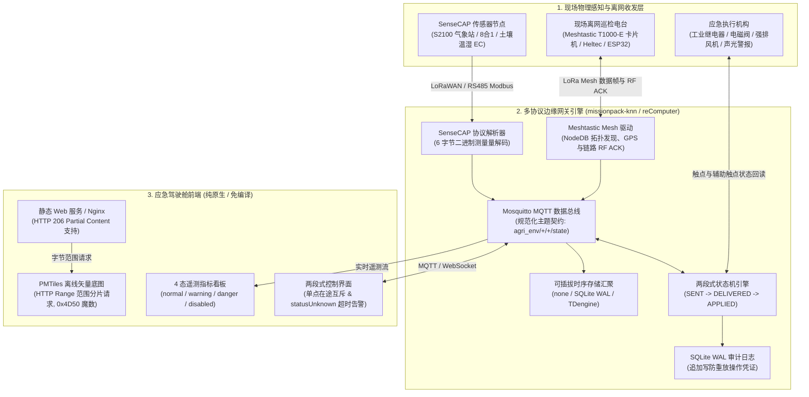

# SenseCraft 应急响应与离网指挥驾驶舱 (Emergency Response Cockpit)

[](LICENSE)
[](#硬件与协议支持矩阵)
[](#系统架构)
[](#离线地图配置指引-pmtiles)
[](#核心特性)

轻量级、全离网应急响应与防灾减灾驾驶舱前端模板，严格遵循 SenseCraft-UI 设计规范。专为边缘网关（如 Seeed reComputer R1000/R1100/R12、树莓派等工业主机）及零公网野外作业场景设计。

[English](README.md) | 简体中文

---

## 系统架构

驾驶舱并非孤立的前端应用，而是作为 Seeed 多协议边缘网关基座（如运行在 reComputer 工业网关上的 `missionpack-knn`）的运行呈现中枢。端到端系统架构涵盖现场感知采集、离网自组网对讲、两段式物理闭环控制及客户端离线 GIS 瓦片渲染：



---

## 核心特性

1. **SenseCraft-UI 统一视觉系统**
   - 严格实现 `@suharvest/ui-kit` 设计 Tokens（主色 `--sc-color-primary: #8CC020`，背景色 `--sc-color-bg-layout: #f7fbf0`）。
   - 标准化 4 态遥测指标徽章：`normal`（正常-绿）、`warning`（警告-黄）、`danger`（危险-红）、`disabled`（禁用/离线-灰）。
   - 内置完整中英双语字典（`en` / `zh`），支持顶栏快速切换或通过 URL 查询参数（`?lang=en` / `?lang=zh`）指定。

2. **PMTiles 离线矢量底图**
   - 通过 `protomaps-leaflet` 对本地单文件 `.pmtiles` 发起 HTTP 206 范围请求（HTTP Range Request）。
   - 完全离网运行，彻底摆脱外部 GIS 服务器或公网地图切片依赖。
   - 内置魔数预检机制（`0x4D50` / `'PM'`），若离线瓦片缺失或不可用，可优雅降级至在线 OpenStreetMap 或测点信息卡片列表。

3. **两段式物理控制状态机引擎**
   - 彻底杜绝在防灾排涝、应急通风等安全关键操作中的前端乐观“假成功”。
   - **阶段 1：`SENT`**：本地网关完成指令校验并确认下发至物理传输链路。
   - **阶段 2：`DELIVERED`**：远端收发机通过 Meshtastic LoRa RF ACK 报文确认帧已送达。
   - **阶段 3：`APPLIED`**：执行器物理辅助触点/继电器状态回读确认，完成硬件级闭环。
   - 超时未收到回读确认自动转入 `statusUnknown` 警告态，并在网关端写入持久化 SQLite WAL 审计追踪日志。

4. **解耦的时序存储汇聚机制**
   - 兼容边缘网关的 `STORAGE_BACKEND` 配置：`none`（纯内存流式透传）、`sqlite`（本地环形存储带 WAL）、`tdengine`（工业级高吞吐时序库集群）。
   - 前端自动感知后端存储能力，并在纯流式模式下自适应调整时序趋势展示策略。

5. **零重型框架与边缘极致优化**
   - 纯原生 ECMAScript 模块与标准 CSS 编写。
   - 生产部署无需 Node.js 编译流水线；仅需几十 MB 内存即可在低功耗边缘工控机稳定持久运行。

---

## 多协议边缘网关协同基座

驾驶舱并非孤立的前端展示层，而是与 Seeed 边缘多协议网关底座（如运行在 reComputer 工业工控机上的 `missionpack-knn` 网关系统）深度协同的运行中枢。网关作为现场硬件设备与驾驶舱统一遥测总线之间的协议适配与控制中枢，承担以下 5 大关键机制：

### 1. SenseCAP 传感器协议适配
- **6 字节二进制测量量精准解析**：工业传感器报文严格按照每组 6 字节二进制步进解码（`Measurement ID` [2 字节] + `Measurement Value` [4 字节，IEEE 754 浮点数或有符号整型]），完全对齐 Seeed 官方 SenseCAP 数据规范。
- **设备配置无缝适配**：原生支持 SenseCAP S2100 传感器采集节点、8 合 1 微气象站、多层土壤温湿度与电导率（EC）传感器、光合有效辐射（PAR）等感知终端。
- **双通道物理层接入**：同时支持 ChirpStack v4 LoRaWAN 上行报文与工业 RS485 Modbus RTU 总线轮询采集。
- **逐点故障隔离与时序对齐**：逐测点异常捕获，单项传感器通信故障不影响其他通道；具备毫秒级时间戳归一化和单调时间防倒流校验。

### 2. Meshtastic LoRa Mesh 离网通信驱动
- **无蜂窝网络应急协同**：在深山密林、灾后通信中断或公网盲区中，构建去中心化的自组网协同链路。
- **巡护终端广泛兼容**：无缝对接手持巡检终端，包括 Seeed SenseCAP T1000-E 追踪卡片机、Heltec LoRa Mesh 节点及各类 ESP32 终端。
- **NodeDB 拓扑与节点发现**：实时维护节点数据库（NodeDB）、多跳传输路由、跳数统计（Hop Count）及信噪比（SNR）链路质量监控。
- **遥测与 GPS 定位解码**：对定点 `1e7` 经纬度做精准浮点还原，保留合法零值经纬度，排查电量字段布尔误判，并支持应急短文本群发广播。
- **链路级硬件 RF ACK 送达确认**：捕获对端 Mesh 电台返回的物理链路 RF ACK 确认帧，作为关键指令与呼叫送达的硬凭证。

### 3. 两段式物理控制状态机引擎
- **严禁乐观假成功**：在防洪排涝泵启动、应急通风卷帘、高音警报器启闭等生命财产安全场景下，未收到物理反馈前决不渲染“成功”。
- **三阶段严格闭环**：
  - `SENT`：指令通过合法性校验，已从网关本地串行总线或射频前端正式发出。
  - `DELIVERED`：远端执行器电台通过 Meshtastic RF ACK 或总线 Echo 确认命令数据完整接收。
  - `APPLIED`：执行器硬件辅助触点动作闭合，通过 GPIO 或 Modbus 线圈读取实际物理状态，闭环完成。
- **单点在途互斥机制**：针对同一设备目标引脚强加互斥锁（同一时间只允许 1 笔在途控制指令），杜绝并发冲突与抖动。
- **单调时钟超时降级**：基于单调时钟（`time.monotonic()`）运行超时监控；若在设定窗口内未收到触点闭合反馈，状态立即升级为 `statusUnknown` 告警态。
- **SQLite WAL 独立审计账本**：每次控制请求的下发操作者、目标参数、阶段跃迁时间戳与最终结果，均持久化写入网关本地 SQLite WAL 审计表，断电不丢失，具备强抗重放与责任溯源能力。

### 4. 可插拔时序存储汇聚
- **动态后端切换**：通过边缘网关的环境变量 `STORAGE_BACKEND` 灵活配置，无需改动上层业务逻辑：
  - `none`：纯内存流式模式。传感器数据与控制事件通过 MQTT/WebSocket 极速推向前端，内存开销近乎为零，适用于低配嵌入式网关。
  - `sqlite`：本地环形缓冲存储，启用 WAL（预写日志）模式。保留滚动时序数据（如 24 小时或 48 小时），自动按时间分区老化，保障断电后历史趋势连续不失真。
  - `tdengine`：接入工业级高并发时序数据库集群，满足大规模站点、高频采样的海量历史时序归档与回溯需求。
- **自适应看板渲染**：驾驶舱自动探测网关存储能力，流式模式下展示即时刷新指示，持久化模式下渲染多天时序折线图与统计分析。

### 5. 规范化 MQTT 数据总线契约
- **前后端松耦合规范**：前端展现与后端采集守护进程之间严格通过契约化的 MQTT 主题流进行通信：
  - **环境遥测状态流**：`agri_env/{station_id}/{sensor_type}/state`（例如 `agri_env/station_alpha/soil/state`、`agri_env/station_alpha/weather/state`），标准 JSON 载荷定义如下：
    ```json
    {
      "station_id": "station_alpha",
      "sensor_type": "weather",
      "timestamp": 1729411200000,
      "metrics": {
        "air_temperature": 24.5,
        "air_humidity": 68.2,
        "barometric_pressure": 1013.2,
        "wind_speed": 3.4,
        "wind_direction": 180,
        "rainfall_hourly": 0.0
      },
      "status": "normal"
    }
    ```
  - **离网巡检主题**：`msh/{mesh_channel}/node/{node_id}/telemetry`，携带巡护人员实时 GPS 经纬度、电池电量与状态指标。
  - **物理控制总线契约**：`control/command` 负责指令投递；`control/state` 负责广播两段式状态机跃迁（`SENT`、`DELIVERED`、`APPLIED`、`statusUnknown`）。

---

## 快速开始

### 方式 1：Python 静态文件服务（零构建，秒级拉起）

直接使用 Python 内置 HTTP 服务器承载目录：

```bash
# 启动 HTTP 8080 端口服务
python3 -m http.server 8080

# 浏览器访问：
# 默认中文界面：http://localhost:8080/index.html
# 英文界面：http://localhost:8080/index.html?lang=en
# 中文界面：http://localhost:8080/index.html?lang=zh
```

### 方式 2：Docker 容器部署（生产级 Nginx）

使用仓库自带的生产级容器配置（`Dockerfile` 与 `nginx.conf`）一键构建运行。Nginx 配置原生支持 HTTP 206 Range 范围请求，对 `.pmtiles` 切片跳过 gzip 压缩以保持严格的字节偏移：

```bash
# 构建 Docker 镜像
docker build -t emergency-response-cockpit .

# 启动容器并挂载本地 PMTiles 离线地图目录
docker run -d \
  --name emergency-cockpit \
  -p 8080:80 \
  -v $(pwd)/uploads/pmtiles:/usr/share/nginx/html/uploads/pmtiles:ro \
  emergency-response-cockpit

# 验证容器健康检查
curl -f http://localhost:8080/healthz
```

### 方式 3：Vite 本地开发调试

适合前端组件二次开发与热重载调试：

```bash
npm install
npm run dev
```

---

## 离线地图配置指引 (PMTiles)

驾驶舱通过 PMTiles v3 格式实现无外网依赖的高清矢量底图渲染：

1. **准备矢量切片**：生成或下载目标区域的 `.pmtiles` 矢量切片文件（可通过 Tippecanoe、Planetiler 或相关切片脚本生成）。
2. **存入目标目录**：将 `.pmtiles` 文件放置在 `uploads/pmtiles/` 目录下（如 `uploads/pmtiles/site.pmtiles`）。
3. **HTTP 206 Range 支持验证**：在生产部署中，`nginx.conf` 已默认配置针对 `.pmtiles` 文件的 `Accept-Ranges bytes` 响应头，并对该后缀关闭 gzip 压缩，确保字节偏移严格准确。
4. **魔数预检与平滑回退**：前端地图组件（`src/components/OfflineMapView.js`）会在加载前通过 HTTP Range 预检前 2 个字节魔数（`0x4D50` 即 ASCII `'PM'`）。若文件不可访问或损坏，将优雅降级至在线 OpenStreetMap 切片（如处于联网环境）或表格化标记卡片列表。

---

## 行业落地示例

本仓库内置一套完整可运行的官方行业落地参考实现：

- [**examples/agri-env-ops**](examples/agri-env-ops/README.md)：**智慧农业气象与离网巡护监控看板**
  - **业务场景**：覆盖大田农田微气象站（温湿度、风向玫瑰图、降雨量、气压）、温室大棚土壤水盐墒情剖面，以及巡检人员携带 Meshtastic LoRa Mesh 电台（T1000-E）的野外轨迹与状态监控。
  - **边缘网关协同**：深度对接 `missionpack-knn` 边缘网关，解析标准 Seeed SenseCAP 传感器报文并订阅 `agri_env/+/+/state` MQTT 主题流。
  - **内置仿真器**：包含 Python 桥接与演示仿真器（`python3 bridge.py --demo`）、独立全功能运营看板、现场壁挂屏视图（`kiosk.html`）以及 Docker Compose 一键启动编排。

---

## 硬件与协议支持矩阵

| 类别 | 支持硬件与协议 | 应用功能定位 |
| :--- | :--- | :--- |
| **边缘网关主机** | Seeed reComputer R1000 / R1100 / R12、树莓派 4 / 5、CM4 工业网关 | 网关运行时宿主、Mosquitto MQTT 代理、SQLite WAL 审计数据库、PMTiles 静态服务 |
| **感知采集节点** | SenseCAP S2100 系列采集器（土壤温湿 EC、空气温湿压、8合1微气象站） | 大田微气象、土壤水盐剖面及地质灾害物理环境数据采集（RS485 / LoRaWAN） |
| **离网巡检终端** | SenseCAP T1000-E 追踪卡片机、Heltec LoRa Mesh 节点、ESP32 LoRa 终端 | 巡护人员离网轨迹上报、野外 GPS 坐标传输及链路级 RF ACK 回执接收 |
| **协议引擎支持** | SenseCAP 测量协议、LoRaWAN、Meshtastic LoRa RF、MQTT、PMTiles v3 | 归一化 6 字节传感器解码、Mesh RF ACK 校验、HTTP 206 瓦片分片流式加载 |
| **应急执行机构** | 工业继电器、Modbus 线圈、GPIO 继电器模块 | 强排泵、风机卷帘与警报器两段式确认控制及触点回读闭环 |

---

## 项目目录结构

```text
emergency-response-cockpit/
├── Dockerfile                     # 生产级 Nginx 容器定义
├── LICENSE                        # MIT 开源许可证
├── README.md                      # 英文文档与架构指南
├── README.zh-CN.md                # 简体中文完整镜像文档与网关协同架构指南
├── index.html                     # 驾驶舱主入口（SenseCraft AppShell 布局）
├── nginx.conf                     # Nginx 服务配置（含 HTTP 206 Range 瓦片支持）
├── package.json                   # 项目元数据与开发依赖
├── docs/
│   └── esg-emergency-solution-handoff.md  # ESG 与防灾应急韧性方案架构交接文档
├── src/
│   ├── main.js                    # 业务调度、数据轮询与状态机分发
│   ├── i18n/
│   │   └── index.js               # 中英双语词典与语言切换器
│   ├── theme/
│   │   └── tokens.css             # SenseCraft UI 官方设计系统 Tokens
│   └── components/
│       ├── MetricCard.js          # 4 态遥测指标卡片组件
│       ├── OfflineMapView.js      # PMTiles 离线矢量地图组件（带在线 OSM 降级）
│       └── TwoPhaseControlButton.js # 两段式物理控制确认按钮组件
└── examples/
    └── agri-env-ops/              # 智慧农业气象与 Meshtastic 巡检示例看板
        ├── Dockerfile             # 示例容器配置
        ├── README.md              # 示例场景与运行文档
        ├── bridge.py              # 协议桥接器与演示仿真服务器
        ├── docker-compose.yml     # 多容器编排文件
        ├── index.html             # 农业综合运营看板入口
        ├── kiosk.html             # 现场巡视屏/信息亭全屏视图
        └── ...                    # 关联样式与脚本资源
```

---

## 许可证与方案文档

- 本项目采用 MIT 许可证开源 - 详见 [LICENSE](LICENSE) 文件。
- 更多关于 ESG 科技向善与防灾应急韧性方案设计、跨仓库技术沉淀及业务场景映射，请参阅方案交接文档 [docs/esg-emergency-solution-handoff.md](docs/esg-emergency-solution-handoff.md)。
