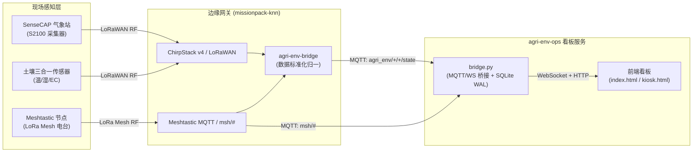

# 智慧农业气象与离网巡田监控看板示例 (Agri-Env Ops)

面向智慧农业气象站、大棚土壤墒情与 Meshtastic 离网通信巡检的 **SenseCraft Emergency Response Cockpit** 官方行业落地示例。

本示例源自实际农田与林果种植现场实践（`agri-env-ops-dashboard`），展示了如何在完全自托管、弱网/离网环境下，通过边缘网关汇聚多传感器数据与 LoRa Mesh 报文，并提供高可读性、免编译的前端监控看板。

---

## 业务场景与特性

1. **农田微气象多测点监控**
   - 气象站核心指标：空气温度、相对湿度、大气压强、光照强度、PM2.5 / PM10、雨量强度（mm/h）；
   - 24 / 48 小时历史时序趋势图（SVG 矢量平滑绘制，断网间隙不虚假插值）；
   - 48 小时极坐标风玫瑰图（Wind Rose）：统计风向频次分布与风速分级色彩映射。

2. **土壤墒情精准监测**
   - 采集根系层土壤温度、土壤体积含水率（Moisture）、土壤电导率（EC）；
   - 实时双弧形仪表盘与时序变化跟踪，为灌溉决策提供依据。

3. **Meshtastic LoRa Mesh 离网通信巡检**
   - 现场巡检员手持 Meshtastic 电台在无公网信号覆盖的农田穿行；
   - 自动解析 Mesh 广播报文中的节点信息（Node Info）、电池电量、跳数（Hops）、GPS 坐标与即时文本消息；
   - 纯前端 SVG 离网节点轨迹/相对位置地图呈现，实现现场人员安全与设备状态跟踪。

4. **开箱即用与双视图形态**
   - **`index.html` (Operations 主看板)**：全功能运营看板，含测点钻取弹窗、风玫瑰、趋势图与 Mesh 通信流；
   - **`kiosk.html` (现场巡视屏/信息亭)**：大字号、高对比度大屏仪表看板，适合现场固定壁挂屏展示；
   - **`data.html` & `admin.html`**：传感器明细与数据新鲜度（Data Freshness）健康矩阵诊断页。

---

## 系统架构与边缘网关协同

本示例可与 **`missionpack-knn`**（或基于 reComputer R1000/R1100 的 SenseCraft 边缘工业网关）完全协同运行：



### 协议数据格式

在标准对接模式（`MQTT_SOURCE=bridge`）下，看板消费经过边缘网关标准化的 MQTT Contract：
- **测点状态**：`agri_env/<node_id>/<entity_key>/state`
  - `entity_key` 包含：`temperature`, `humidity`, `co2`, `wind_speed`, `wind_direction`, `rainfall_hourly`, `barometric_pressure`, `light_intensity`, `pm2_5`, `pm10`, `soil_temperature`, `soil_moisture`, `electrical_conductivity`。
  - 负载内容为纯文本数值字符串（Retained 报文）。
- **设备在线状态**：`agri_env/<node_id>/availability`（`online` 或 `offline`）。
- **设备元数据**：`homeassistant/sensor/<node_id>/<entity_key>/config`。
- **Meshtastic 离网流**：`msh/#`（JSON 格式报文，支持 `nodeinfo`, `position`, `text`）。

---

## 快速运行指南

### 方式 1：一键 Demo 模式（无需任何 Broker 或外部硬件）

内置合成数据生成器，包含 48 小时历史时序、风玫瑰样本、大棚传感器与模拟移动巡检员轨迹：

```bash
# 1. 进入目录并安装轻量依赖 (paho-mqtt, websockets)
cd examples/agri-env-ops
pip install -r requirements.txt

# 2. 启动 Demo
python3 bridge.py --demo
```
打开浏览器访问：
- **主运营看板**：`http://localhost:8000/` 或 `http://localhost:8000/index.html`
- **现场信息亭看板**：`http://localhost:8000/kiosk.html`
- **系统诊断面板**：`http://localhost:8000/admin.html`

> [!TIP]
> 支持通过页面右上角切换中英文界面（中文 / English）。

---

### 方式 2：真实边缘网关对接模式

在边缘网关环境中，对接本地或远程 MQTT Broker：

```bash
# 1. 复制配置文件模板
cp .env.example .env

# 2. 修改 .env 中的 MQTT Broker 参数
# MQTT_HOST=127.0.0.1
# MQTT_PORT=1883
# MQTT_SOURCE=bridge
# MQTT_TOPIC=agri_env/+/+/state

# 3. 运行桥接服务
MQTT_SOURCE=bridge python3 bridge.py --env-file .env
```

---

### 方式 3：Docker / Docker Compose 部署

适用于需要作为常驻服务自启动的生产现场：

```bash
# 启动容器服务
docker compose up -d

# 查看运行日志与健康检查
docker compose logs -f
```

服务将自动暴露：
- **HTTP 端口**：`8000`（Web 看板与 REST API `/api/health`, `/api/overview`, `/api/history`）
- **WebSocket 端口**：`8765`（实时指标广播推送）
- **SQLite 卷**：数据持久化保存至 `bridge-data` 命名卷中。

---

## 扩展指引：升级为两段式闭环控制

当前 `agri-env-ops` 主要聚焦于现场态势感知与无源监测（Receive-only）。若需要控制农田大棚内的执行机构（如灌溉水泵、电动卷帘、应急排风机），可遵循 `emergency-response-cockpit` 核心规范进行闭环升级：

1. **引入两段式物理确认组件**
   引入根目录的 [`TwoPhaseControlButton.js`](../../src/components/TwoPhaseControlButton.js) 组件替代单向触发开关。

2. **状态机演进流程**
   - **Phase 1: `SENT`**：用户点击确认后，控制指令经 HTTP/MQTT 发送至网关；
   - **Phase 2: `DELIVERED`**：网关或 Meshtastic 对端收到无线 ACK；
   - **Phase 3: `APPLIED`**：远端继电器硬件回读接触器引脚状态，确认触点真正闭合；
   - 若超时未收到真实物理反馈，进入 `statusUnknown` 告警，并由网关保留不可篡改的 SQLite 审计日志。

3. **指令下发主题规范**
   通过 MQTT 下发控制帧至网关下行队列：
   ```json
   // Topic: agri_env/cmd/control
   {
     "target": "pump_station_1",
     "action": "irrigate_start",
     "duration_s": 900,
     "operator": "patrol_team_02",
     "timestamp": 1729137000
   }
   ```

---

## 目录结构

```
examples/agri-env-ops/
├── index.html              # 主运营看板 (Operations 看板，原 dashboard-b)
├── kiosk.html              # 现场信息亭/巡视大屏 (原 dashboard-a)
├── data.html               # 传感器明细与各通道采样曲线
├── admin.html              # 系统诊断与数据源时效健康矩阵
├── ops.css                 # 驾驶舱离线样式与嵌入字体定义
├── ops-core.js             # 核心工具函数 (平滑插值、极坐标计算)
├── dashboard-b-client.js   # 主运营看板前端交互逻辑
├── farm-connection.js      # WebSocket 探活与自适应重连
├── workbench.js            # 数据明细与诊断页交互脚本
├── map.svg                 # 农场矢量拓扑示意图
├── bridge.py               # MQTT 桥接、时序存取与 WebSocket 推送服务
├── demo.py                 # 本地离线合成数据生成器
├── requirements.txt        # Python 依赖清单
├── Dockerfile              # 生产级多架构容器镜像构建文件
├── docker-compose.yml      # Docker Compose 服务编排
├── .env.example            # 环境变量配置模板
└── README.md               # 本使用文档
```
